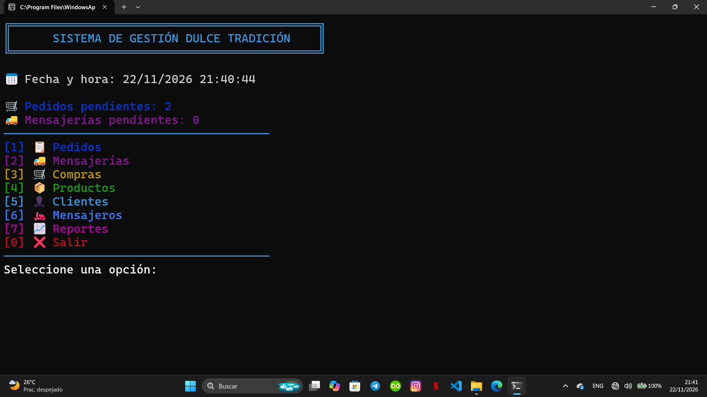
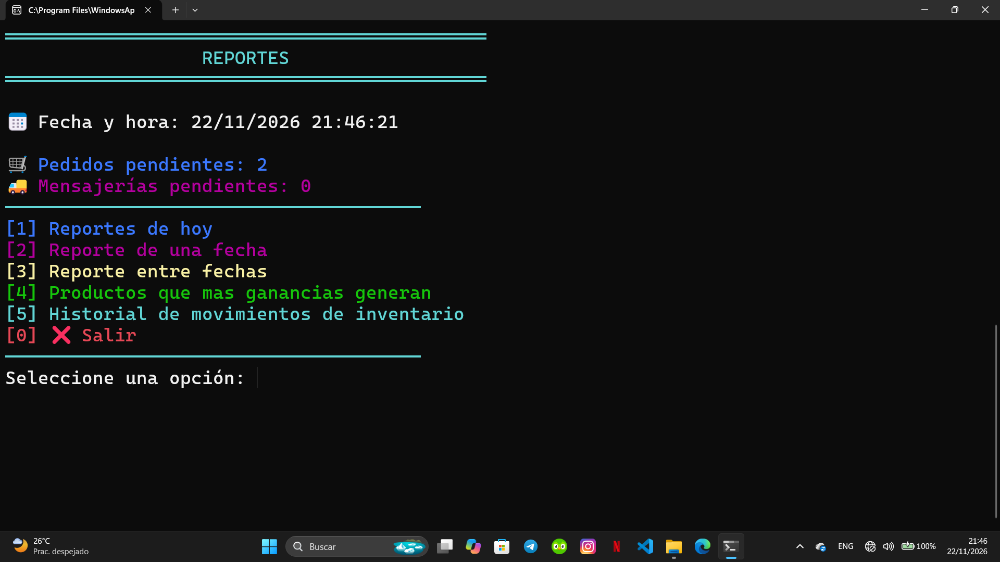
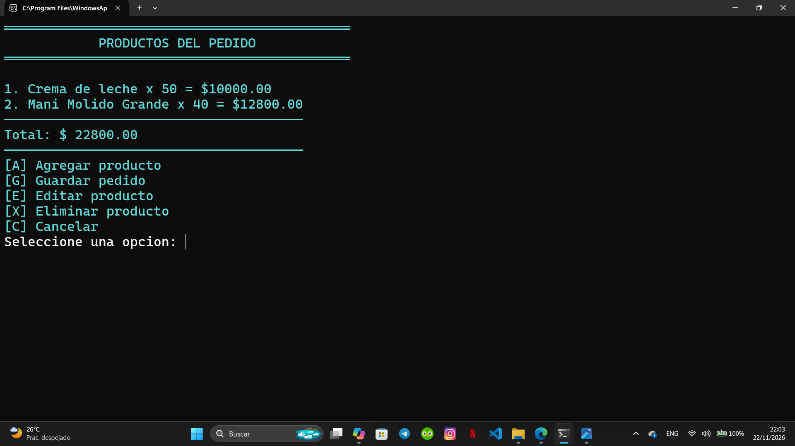
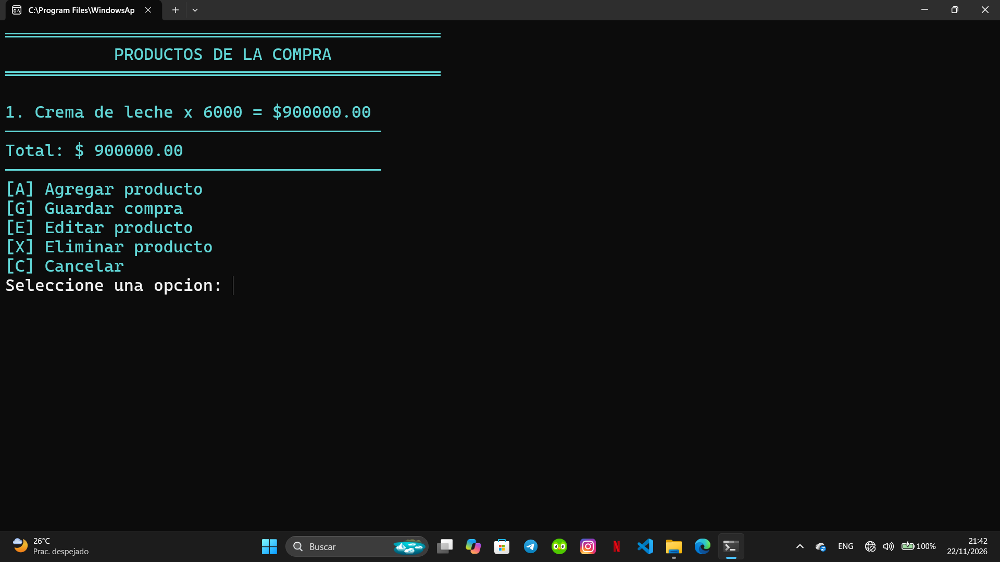
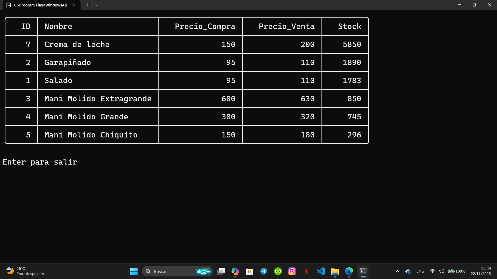
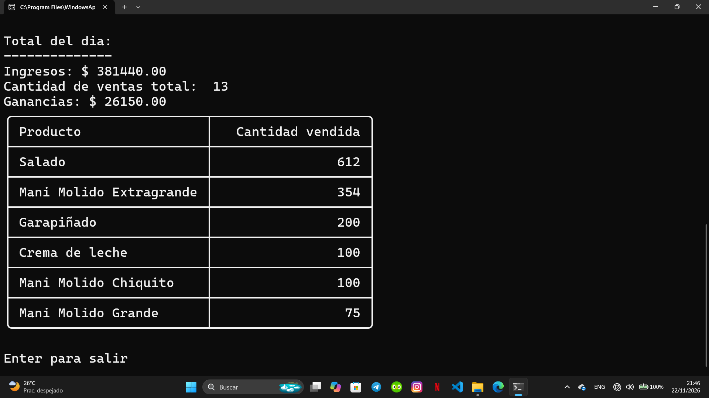
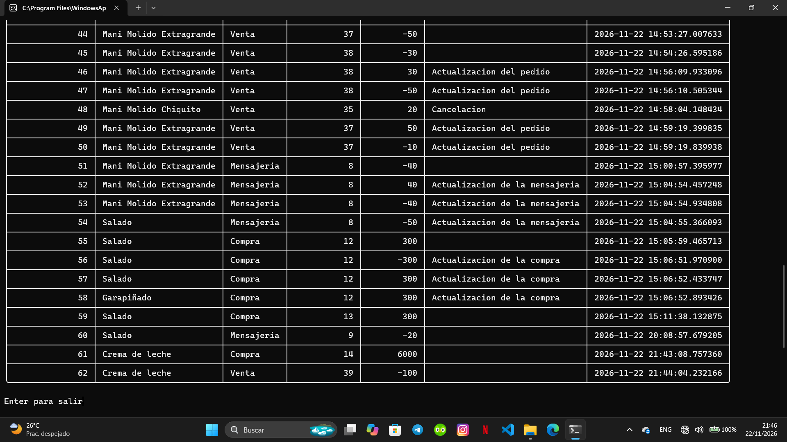

# 🍰 Dulce Tradición

A management system for bakeries, candy stores, and small businesses developed with Python and PostgreSQL.

The application allows users to manage products, customers, sales, deliveries, purchases, and inventory through an intuitive console interface.

---

## ✨ Features

### 📦 Product Management
- Add products.
- Edit products.
- Search products.
- Delete products.
- Stock control.

### 👥 Customer Management
- Register customers.
- Edit customer information.
- Search customers.
- Delete customers.
- Store addresses and notes.

### 🛒 Sales Management
- Create sales.
- Modify sales.
- Cancel sales.
- Automatic inventory updates.
- Sales history tracking.

### 🚚 Delivery Management
- Create home delivery orders.
- Assign delivery drivers.
- Order status management:
  - Pending
  - Shipped
  - Delivered
  - Cancelled
- Delivery cost tracking.

### 🏪 Purchase Management
- Register purchases from suppliers.
- Automatic inventory updates.
- Purchase history tracking.

### 📊 Inventory Management
- Purchase entries.
- Sales outputs.
- Delivery outputs.
- Manual stock adjustments.
- Inventory movement history.

### 📈 Reports
- Sales by date.
- Sales between dates.
- Daily reports.
- Best-selling products.
- Profit by product.
- Profit by period.

---

## 📸 Screenshots

### Main Menu



The main dashboard provides quick access to all system modules, including orders, deliveries, purchases, products, customers, couriers, and reports.

---

### Reports Menu



Access different types of business reports, including daily reports, specific-date reports, date-range reports, profitability analysis, and inventory movement tracking.

---

### Sales Management



Create and manage customer orders with automatic total calculation, product editing, and order cancellation options.

---

### Purchase Management



Register purchases from suppliers and automatically update inventory levels.

---

### Inventory



View current inventory levels, purchase prices, selling prices, and stock availability.

---

### Daily Reports



Analyze daily business performance, including revenue, profits, sales volume, and best-selling products.

---

### Inventory Movement History



Complete traceability of inventory operations, including purchases, sales, deliveries, adjustments, and cancellations.

---

## 🛠 Technologies Used

- Python
- PostgreSQL
- Psycopg
- Colorama
- Tabulate
- PyInstaller

---

## 📁 Project Structure

```text
inventario_app/
│
├── gui/
├── models/
├── main.py
├── database.py
├── crear_tablas.py
└── README.md
```

---

## 🚀 Installation

### 1. Install PostgreSQL

Download and install PostgreSQL on your system.

### 2. Create the Database

```sql
CREATE DATABASE dulce_tradicion;
```

### 3. Create the Tables

```bash
python crear_tablas.py
```

Or execute the table creation function included in the project.

### 4. Run the Application

```bash
python main.py
```

---

## 🗄 Database

The application uses PostgreSQL and includes the following main entities:

- Products
- Customers
- Delivery Drivers
- Deliveries
- Sales
- Purchases
- Suppliers
- Inventory Movements

---

## ⭐ Highlights

- Automatic inventory control.
- Delivery management.
- Profit tracking.
- Historical movement records.
- Sales and purchasing workflows.
- Advanced reporting system.
- PostgreSQL-based data persistence.
  
---

## 👨‍💻 Author

Developed by **Rodolfo Sanchez** as a management system project for bakeries, candy stores, and small businesses.

